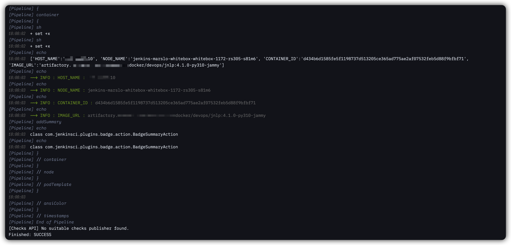

# iFonts Jenkins (marslo)

Jenkins-only font customization: configurable sans / mono / handwritten / icon font stacks for Jenkins controllers.

## Installation

1. install [Stylus](https://github.com/openstyles/stylus): [Chrome](https://chromewebstore.google.com/detail/stylus/clngdbkpkpeebahjckkjfobafhncgmne) | [Firefox](https://addons.mozilla.org/firefox/addon/styl-us/) | [Edge](https://microsoftedge.microsoft.com/addons/detail/stylus/dmcfbglnmkadeibaoelljihicilhlnjd)
2. click to install:

| STYLE                   | SCOPE             | INSTALL                                                                                                                                                             | REPO                                                                 |
| ----------------------- | ----------------- | ------------------------------------------------------------------------------------------------------------------------------------------------------------------- | -------------------------------------------------------------------- |
| iFonts Jenkins (marslo) | jenkins           | 📦 [GitHub raw](https://github.com/marslo/ifonts-jenkins/raw/main/ifonts-jenkins.user.css) \| [userstyles.world](https://userstyles.world/api/style/30122.user.css) | 🏘 [marslo/ifonts-jenkins](https://github.com/marslo/ifonts-jenkins) |
| iFonts (marslo)         | universal domains | 📦 [GitHub raw](https://github.com/marslo/ifonts/raw/main/ifonts.user.css) \| [userstyles.world](https://userstyles.world/api/style/5264.user.css)                  | 🏘 [marslo/ifonts](https://github.com/marslo/ifonts)                 |
| iFonts GitHub (marslo)  | github            | 📦 [GitHub raw](https://github.com/marslo/ifonts-github/raw/main/ifonts-github.user.css) \| [userstyles.world](https://userstyles.world/api/style/30123.user.css)   | 🏘 [marslo/ifonts-github](https://github.com/marslo/ifonts-github)   |

> [!IMPORTANT]
> Fonts are referenced by family name — install them locally first ( see [fonts download](#fonts-download) ). Missing fonts fall back to the next one in the stack.

## Scope

The style applies to the hosts matched by `@-moz-document regexp(...)`:

| PATTERN                                                      | EXAMPLE                                         |
| ------------------------------------------------------------ | ----------------------------------------------- |
| `*jenkins*.com` ( excluding gitpod )                         | `jenkins.example.com`, `my-jenkins.example.com` |
| `ci.jenkins.io`                                              | the public Jenkins project CI                   |
| `imarslo.jenkins.com` and a few private controller IP ranges | marslo's own controllers                        |

> [!TIP]
> To use it on another Jenkins host, add a `regexp(...)` / `domain(...)` entry to the `@-moz-document` list ( Stylus → edit style ).

## Configuration

Stylus → style ⚙ **Configure**:

| OPTION            | VARIABLE                  | DEFAULT ( FIRST ENTRIES )                                                                                               |
| ----------------- | ------------------------- | ----------------------------------------------------------------------------------------------------------------------- |
| Sans Fonts        | `font-family-sans`        | `Titillium Nerd Font Upright`, `Titillium Nerd Font`, `Gisha Nerd Font`, `Recursive Sans Casual Static Nerd Font`, …    |
| Mono Fonts        | `font-family-mono`        | `Blex` ( BlexMonoLig Book / Text ), `BlexMonoLig Nerd Font Mono`, `OperatorMonoSSmLig Nerd Font Mono`, …                |
| Handwritten Fonts | `font-family-handwritten` | `Papyrus Nerd Font`, `fantasy`                                                                                          |
| Icon Fonts        | `font-family-icon`        | `Google Material Icons`, `Material Icons Extended`, Font Awesome, … ( applied to icon elements so glyphs still render ) |

## Fonts download

> [!TIP]
> More details: [iMarslo: fonts](https://marslo.github.io/ibook/tools/fonts.html)

### Sans

| FONT                         | NERD FONT                                                                                                         | UPSTREAM                                                                                                               |
| ---------------------------- | ----------------------------------------------------------------------------------------------------------------- | ---------------------------------------------------------------------------------------------------------------------- |
| Recursive Sans Casual Static | [Recursive Sans Casual Static Nerd Font](https://github.com/marslo/fonts/tree/fonts/Recursive/RecursiveDesktopNF) | [releases](https://github.com/arrowtype/recursive/releases) \| [Recursive](https://www.recursive.design/)              |
| Ubuntu                       | —                                                                                                                 | [ubuntu](https://design.ubuntu.com/font) \| [preview](https://fonts.google.com/specimen/Ubuntu)                        |
| Candara                      | [Candara Nerd Font](https://github.com/marslo/fonts/tree/fonts/Candara)                                           | [Candara](https://www.dafontfree.io/candara-font)                                                                      |
| Gisha                        | [Gisha Nerd Font](https://github.com/marslo/fonts/tree/fonts/Gisha)                                               | [Gisha](https://learn.microsoft.com/en-us/typography/font-list/gisha)                                                  |
| Titillium                    | [Titillium Nerd Font](https://github.com/marslo/fonts/tree/fonts/Titillium)                                       | [Titillium](https://fonts.adobe.com/fonts/titillium-web) \| [preview](https://fonts.google.com/specimen/Titillium+Web) |

### Mono

| FONT            | NERD FONT                                                                                                                                                                                                  | UPSTREAM                                                                                                           |
| --------------- | ---------------------------------------------------------------------------------------------------------------------------------------------------------------------------------------------------------- | ------------------------------------------------------------------------------------------------------------------ |
| BlexMonoLig     | [BlexMonoLig Nerd Font Mono](https://github.com/marslo/fonts/tree/fonts/Blex/IBMPlexMonoLigNF)                                                                                                             | —                                                                                                                  |
| LektonLig       | [LektonLig Nerd Font Mono](https://github.com/marslo/font-lekton/tree/main/LektonLigNF) \| [mirror](https://github.com/marslo/fonts/tree/fonts/Lekton/LektonLigNF)                                         | —                                                                                                                  |
| Operator Mono   | [OperatorMonoLig Nerd Font Mono](https://github.com/marslo/fonts/tree/fonts/Operator/OperatorMonoLigNF) \| [OperatorMono Nerd Font Mono](https://github.com/marslo/fonts/tree/fonts/Operator/OperatorMono) | —                                                                                                                  |
| Monaco          | [Monaco Nerd Font Mono](https://github.com/marslo/fonts/tree/fonts/Monaco)                                                                                                                                 | [Monaco](https://www.cufonfonts.com/font/monaco)                                                                   |
| Rec Mono Casual | [RecMonoCasual Nerd Font Mono](https://github.com/marslo/fonts/tree/fonts/Recursive/RecursiveCodeNF/RecMonoCasual)                                                                                         | [Rec Mono Casual](https://github.com/arrowtype/recursive/tree/main/fonts/ArrowType-Recursive-1.085/Recursive_Code) |
| Comic Mono      | [ComicMono Nerd Font Mono](https://github.com/marslo/fonts/tree/fonts/ComicMono)                                                                                                                           | [Comic Mono](https://dtinth.github.io/comic-mono-font/)                                                            |
| Gohu            | [Gohu](https://github.com/ryanoasis/nerd-fonts/tree/master/patched-fonts/Gohu)                                                                                                                             | —                                                                                                                  |

### More

- [Nerd Fonts Patched by v3.2.1.1](https://github.com/marslo/fonts/tree/fonts) | [nerd-font](https://www.nerdfonts.com/font-downloads) | [ryanoasis/nerd-fonts](https://github.com/ryanoasis/nerd-fonts)
- [powerline/fonts](https://github.com/powerline/fonts)

## Author

[Marslo Jiao](mailto:marslo.jiao@gmail.com) · [MIT License](./LICENSE)
